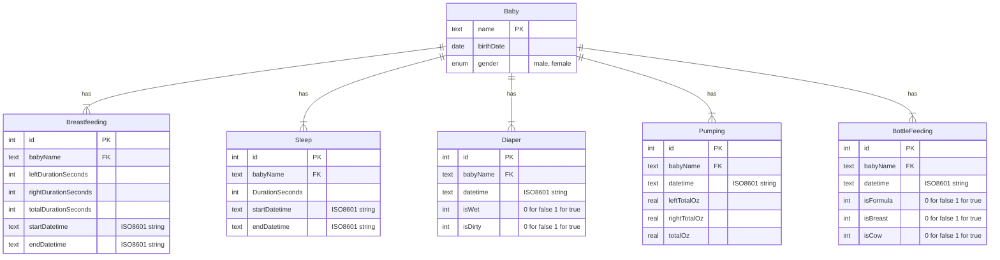

# Baby Stats
I want to create charts from the data Hokulani has been collecting about the children's feeding, diapers, and sleep. The app she uses allows her to export a csv file which we can then parse and then put into a sqlite db. We will then query the data in the db and create charts using GO ECharts, which uses Apache ECharts. It will be nifty.

## The Data
The first thing to do is to determine the kind of data we have to work with and categorize them as dimensions and measures. This will help determine the schema for the db and inform what kinds of charts would be best to visualize the data.

### Name/Baby
Type: Dimension

Each event, ie sleep, feeding, diapers, is associated with a name/baby.

### Event type
Type: Dimension

The type of an event. Each entry made in the baby tracking app will be considered an event.

Event Types:
- Breastfeeding
- Sleep
- Diaper Change
- Custom (may not worry about this one)
- Pumping
- Bottle Feeding
- Solid Food
- Tummy Time

Something I am noticing here is that there are multiple things that have to do with feeding. Breastfeeding, bottle feeding, and solid food. Perhaps pumping could be included too. I wonder if it makes sense to also have a category?

### Category?
Type: Dimension

The category of an event. May have this because things like Breastfeeding, Bottle feeding, and Solid Food are all "feedings".

### Day
Type: Dimension

The day on which an event occurred

### Time
Type: Dimension

The time at which an event occurred

### Detail
Type: Measure

So the CSV just has one columnd called detail. In this column it includes things like the duration, or an amount, or a duration per breast etc. It really just depends on the event type. So perhaps I will have a detail type for each event type.

#### Breastfeeding Detail
| Field | Type | Unit |
| ----- | ---- | ---- |
| Left Duration | Measure | Minutes and seconds |
| Right Duration | Measure | Minutes and seconds |
| Total Duration | Measure | Minutes and seconds |

#### Sleep Detail
| Field | Type |
| ----- | ---- |
| Hours | Measure |
| Minutes | Measure |

In Anela's data, there are a few entries where there is either a type of Kaipo, or Anela. Quite interesting... Was Hokulani tracking Kaipo's sleep in Anela's profile for a bit?

#### Diaper Change Detail
| Field | Type |
| ----- | ---- |
| Type | Dimension |

The type is either Pee, Poop, or Mixed

#### Pumping Detail
| Field | Type | Unit |
| ----- | ---- | ---- |
| Left total | Measure | Oz |
| Right total | Measure | Oz |
| Total | Measure | Oz |

#### Bottle Feeding Detail
| Field | Type | Unit |
| ----- | ---- | ---- |
| Amount | Measure | Oz |
| Milk Type | Dimension | N/A |

Milk Type is either cow, breast, or formula

Some of these have a note that say things like also cow milk or formula etc. I will need to decide if I want to include this or just ignore it.

#### Solid Food Detail
| Field | Type | Unit |
| ----- | ---- | ---- |

Seems like there isn't really anything for this one except that it happened. Plus for Anela there are only 4 entries, so I may not worry about this one

#### Tummy Time
| Field | Type | Unit |
| ----- | ---- | ---- |
| Duration | Measure | Minutes | 

### Summary and how do we use this data?
The data for feedings, diapers, and sleep is rather robust. I think I will really focus on these to start.

Our major dimensions are day and time. Diapers also has a type, and bottle feeding has a milk type. We can also compute a dimension of age for each baby.

Our measures are mostly things like feeding durations and amount. We can also compute some measures such as time between feedings, averages, totals etc.

The obvious useful charts are going to be things like line charts to see how feedings and sleep change over time, we could also have some bar charts to show off totals. I think we can start with one or two charts and then add others later. Lets start with feeding duration and sleep duration over time.

## DB Schema
When desiging the schema, I should start by considering how all of this data relates to each other and stuff.

One thing I know for sure is that I will basically be storing a bunch of events and each event will be associated with a baby. So there will definitely be a baby table. I could have a generic event table, but that does not seem ideal. I think it would be typical and better to have a table for each kind of event.

